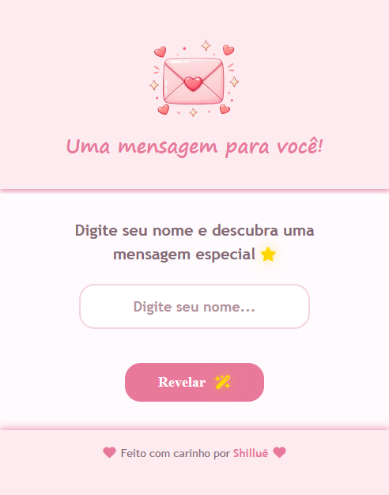
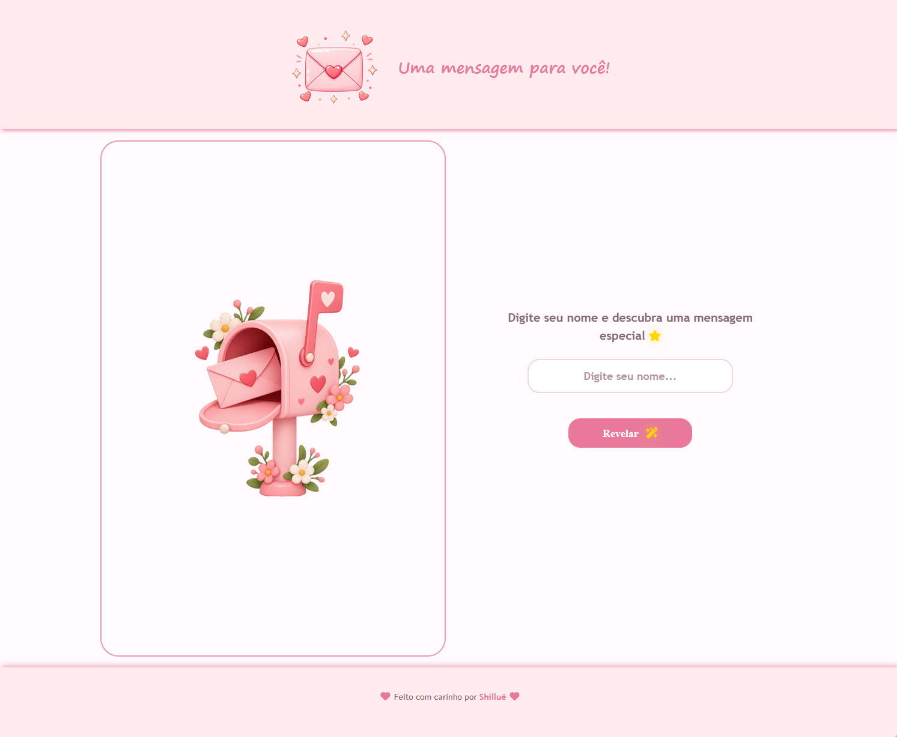

# 💌 Correio Motivacional

Um cantinho virtual para receber mensagens motivacionais e espalhar carinho em forma de palavras. 🌷

## ✨ Sobre o projeto

O Correio Motivacional é uma aplicação responsiva desenvolvida com HTML, CSS e JavaScript, que gera cartões personalizados com frases positivas, molduras delicadas e símbolos fofos.

## 🌸 Funcionalidades

- 💌 Geração aleatória de mensagens motivacionais.   
- 🎀 Cartões com molduras variadas e símbolos decorativos.   
- ✍️ Personalização com o nome do usuário.   
- 📥 Salvamento do cartão como imagem, com ou sem nome.   
- 💗 Compartilhamento da imagem do cartão.    
- 🔗 Criação de links personalizados para compartilhar mensagens.    
- 📱 Layout responsivo para celulares e computadores.    
- 🧩 Organização dos dados em arquivos JSON e do JavaScript em módulos.    

## 🖼️ Pré-visualização

### 📱 Mobile

### 🖥️ Desktop

## 🛠️ Tecnologias

- HTML5 
- CSS3 
- JavaScript 
- JSON 
- ES Modules 
- Font Awesome 
- html-to-image

## 📁 Estrutura do projeto

correio-motivacional/   
├── index.html   
├── assets/    
│   ├── images/    
│   └── molduras/    
├── styles/    
│   ├── style.css    
│   └── responsive.css    
└── js/    
    ├── main.js    
    ├── components/     
    │   ├── message.js     
    │   ├── save.js     
    │   ├── modal.js    
    │   └── compartilha.js    
    └── data/    
        ├── mensagens.json     
        ├── molduras.json     
        └── simbolos.json      

## 🚀 Acesse o projeto

💌 Site: [Correio Motivacional](https://shillue.github.io/correio-motivacional/)

## 👩‍💻 Autoria

Desenvolvido com 💗 e muito carinho por [Shilluê](https://www.linkedin.com/in/shillu%C3%AA/)
